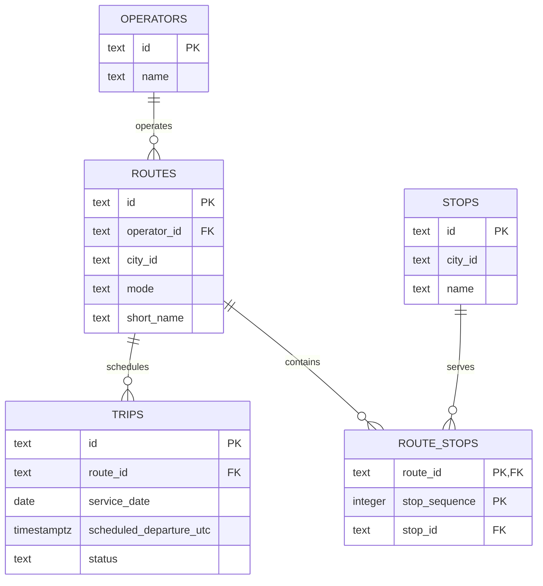

# Lecture 1 ER diagram

This draft models the implemented Lecture 1 scope: operators, routes, stops, route-stop positions, and trips. It is based on `database/postgres/001_relational_baseline.sql`.

## Relationship and key decisions

- One operator can operate many routes; each route refers to one operator.
- One route can have many trips; each trip refers to one route.
- Routes and stops have a many-to-many relationship through `route_stops`.
- `route_stops` uses `(route_id, stop_sequence)` as its composite primary key. This allows a route to visit the same stop more than once, provided each occurrence has a different sequence number. `stop_id` is not part of the key because a stop can occur repeatedly on the same route.
- A route is expected to contain at least one route-stop position. The database foreign keys enforce that each stored route-stop position refers to an existing route and stop, but they do not enforce that every route has a position.

This is a draft of the Lecture 1 relational slice, not the complete platform model. Tickets, payments, validations, vehicles, real-time availability, and reporting are outside this lecture's implemented schema.
